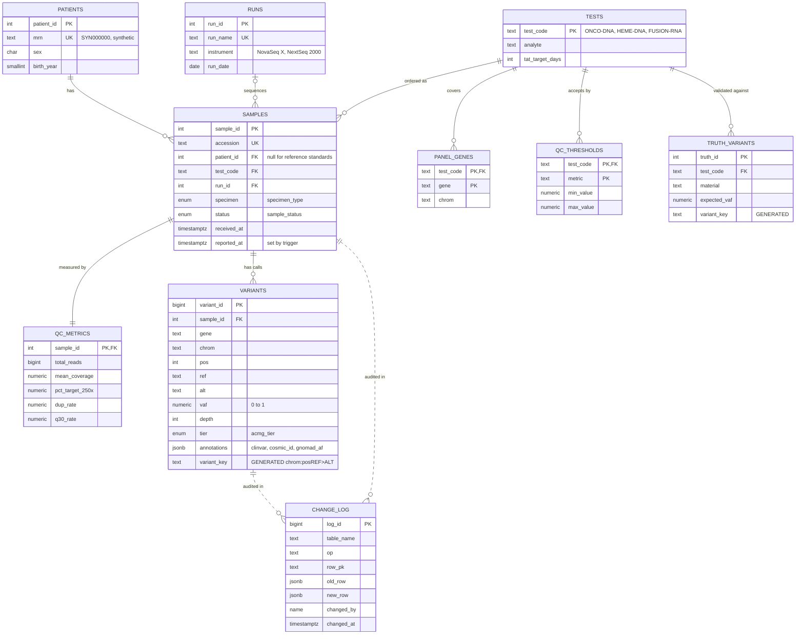

# ngs-lims-postgres

A mini LIMS for a hospital molecular pathology lab running clinical NGS, built almost entirely in PostgreSQL. It tracks patients, specimens, sequencing runs, QC metrics and variant calls for three assays (a solid tumor DNA panel, a myeloid DNA panel and a fusion RNA panel), and it enforces the boring but important rules a CLIA lab lives by: every change is audited, samples move through the lab in order, signed-out results are locked, and each role sees only what it should. There is no Python and no ORM. The schema, business logic, six months of synthetic lab history, tests and the HTML report are all SQL, run through psql.

## Quickstart

You need Docker. Nothing else gets installed locally, and psql runs inside the container.

```bash
make up       # start postgres:16 (creates .env from .env.example if missing)
make reset    # drop everything, rebuild schema, reseed (about 5 seconds)
make test     # run the SQL assertions, prints PASS/FAIL per test
make report   # write report.html with the key analysis tables
```

Also handy:

```bash
make analysis # run every query in sql/08_analysis.sql
make psql     # interactive psql shell
make down     # stop the container (data volume is kept)
```

The database listens on `127.0.0.1:5433` by default (see `.env.example`).

## Layout

```
sql/00_run_all.sql     drops schemas + roles, then \ir's 01..07 in order
sql/01_schema.sql      schemas, enums, tables, constraints, generated column
sql/02_indexes.sql     b-tree, partial, GIN, each with a comment on why
sql/03_functions.sql   PL/pgSQL: QC status, status machine, TAT, concordance
sql/04_triggers.sql    audit trail, sign-out lock, reported_at, QC row stub
sql/05_views.sql       work queue, reportable variants, run QC matview
sql/06_security.sql    roles, explicit GRANT/REVOKE, row-level security
sql/07_seed.sql        all synthetic data via generate_series + setseed(0.42)
sql/08_analysis.sql    11 lab questions answered in SQL
tests/                 plain SQL assertions (run in a rolled-back transaction)
report/                psql --html report template
```

## Data model



## What it shows

| Feature | File | PostgreSQL concept |
|---|---|---|
| Separate `lims`, `audit`, `reporting` schemas | `01_schema.sql` | schemas, ENUM types, CHECK / FK / ON DELETE rules |
| `variant_key` like `chr7:140753336A>T` | `01_schema.sql` | generated columns (`GENERATED ALWAYS ... STORED`) |
| ClinVar / COSMIC / gnomAD annotations | `01_schema.sql`, `08_analysis.sql` Q8 | JSONB, `@>` containment, `?` key existence |
| Fast reportable-variant lookups | `02_indexes.sql`, Q11 | partial index with INCLUDE, verified with EXPLAIN ANALYZE |
| Annotation search | `02_indexes.sql` | GIN index on JSONB |
| QC pass/fail driven by a thresholds table | `03_functions.sql` | PL/pgSQL, OUT params, `to_jsonb(row)` |
| Status state machine | `03_functions.sql`, `04_triggers.sql` | PL/pgSQL, custom SQLSTATEs, BEFORE UPDATE trigger with WHEN |
| Assay concordance (TP / FP / FN) | `03_functions.sql` | FULL OUTER JOIN, GROUPING SETS, RETURNS TABLE |
| CLIA audit trail | `04_triggers.sql` | generic trigger using TG_ARGV, JSONB row images, append-only table |
| Sign-out lock on results | `04_triggers.sql` | row triggers blocking INSERT / UPDATE / DELETE |
| Work queue and reportable variants | `05_views.sql` | views with `security_invoker` |
| Per-run QC snapshot | `05_views.sql` | materialized view, REFRESH CONCURRENTLY, `percentile_cont` |
| Role separation | `06_security.sql` | roles, explicit GRANT / REVOKE, column-level UPDATE grant |
| report_reader sees signed-out only | `06_security.sql` | row-level security policies |
| Reproducible synthetic data | `07_seed.sql` | `generate_series`, `setseed` + `random()`, Box-Muller in SQL |
| Bad run detection | Q2 | window function, `ROWS BETWEEN 4 PRECEDING AND 1 PRECEDING` |
| TAT by month | Q3 | `percentile_cont(0.5 / 0.9)`, `date_trunc` |
| Recurrent hotspots | Q4 | `RANK() OVER (PARTITION BY ...)` |
| Co-occurring mutations | Q5 | self-join |
| Serial VAF monitoring | Q6 | `LAG()` with a named WINDOW |
| Limit of detection | Q7 | `width_bucket` with an explicit bin array |
| Status history from the audit log | Q9 | recursive CTE |
| Per-run pass/fail in one pass | Q10 | aggregate `FILTER (WHERE ...)` |

## Why this matters in a clinical lab

**Audit trail.** CLIA and CAP expect you to show who changed a result or a sample's status, and when. Here every INSERT, UPDATE and DELETE on samples, variants and QC thresholds writes the before and after row as JSONB into `audit.change_log`, along with the role and login user. The log itself rejects UPDATE, DELETE and TRUNCATE. Q9 rebuilds a sample's full journey through the lab from it.

**Sign-out lock.** Once a pathologist signs out a case, the report has gone to the clinician. Quietly editing a variant after that is how patient harm and failed inspections happen. A trigger blocks any insert, edit or delete of calls on a signed-out sample, so a correction has to go through an amended report instead. `reported_at` is stamped by a trigger, not typed in by hand.

**Role separation.** Lab techs move samples through the wet lab, bioinformaticians own calls and QC, and only pathologists can sign out. That last rule is enforced in the status trigger, so it holds even for a direct UPDATE. Report consumers get the `reporting` schema only, and RLS hides any sample that is not signed out, so a preliminary result never leaks into a dashboard.

**Validation metrics.** Before a lab can report a test, it has to prove the assay finds what it should (sensitivity), doesn't invent things (PPV), and know where detection drops off (LOD). `fn_concordance` compares three reference-standard replicates against a truth set. The data is built so detection falls off below 5% VAF and there's one false positive. That gives 88% sensitivity, 98% PPV, and a LOD table that looks like a real validation summary.

## About the data

All data is synthetic and contains no PHI. MRNs are `SYN` plus six digits, and every patient, sample and result is made up by `07_seed.sql` with `setseed(0.42)`, so every `make reset` gives the same database. The hotspots are real GRCh38 positions (KRAS G12D/G12V, BRAF V600E, EGFR L858R, PIK3CA H1047R, TP53 R175H/R273H, JAK2 V617F, IDH1 R132H, DNMT3A R882H, FLT3-ITD and NPM1). Other coordinates, like fusion breakpoints, extra truth-set variants and background calls, are just there to look plausible and land inside the panel genes. None of it is for clinical use.

A few things are built in so the analysis has something to find:
- FFPE samples get lower coverage, more duplicates and shorter inserts.
- The 2026-09-14 NextSeq run is degraded, and Q2 flags it.
- Some patients have serial samples, with VAFs falling on therapy or rising at relapse.
- A few cases are stuck waiting on a pathologist, so the work queue has overdue items.

The seed replays every status change through `fn_advance_status` at its historical time, so the audit log fills up as if a real lab had used it.

One implementation note: `fn_qc_status` returns `PENDING` (not just PASS/FAIL) for samples that haven't been sequenced yet. Every sample gets its `qc_metrics` row at accession, so "one QC row per sample" always holds.
